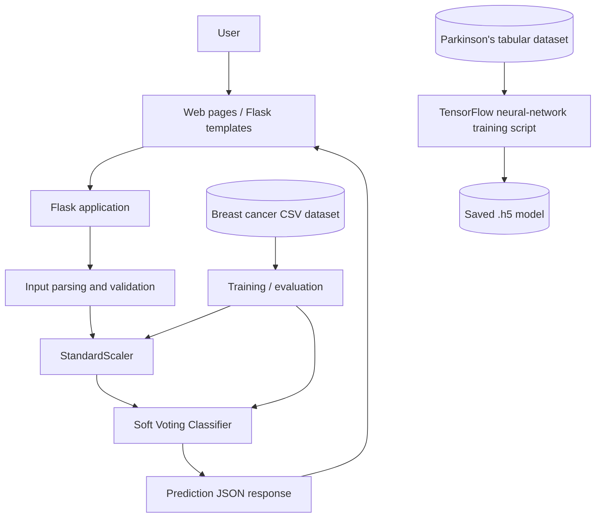
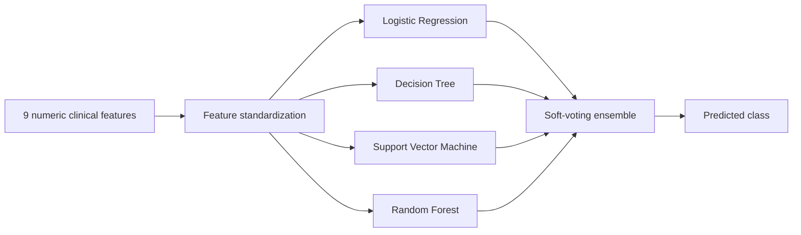

<div align="center">

# 🩺 SpectraScan
### Machine Learning–Powered Disease Screening Research Platform

**Exploring breast cancer and Parkinson's disease classification through clinical features, ensemble learning, and neural networks.**

[](https://www.python.org/)
[](https://flask.palletsprojects.com/)
[](https://scikit-learn.org/)
[](https://www.tensorflow.org/)
[](#limitations-and-safety)

[Overview](#overview) • [Features](#features) • [Architecture](#architecture) • [Getting Started](#getting-started) • [Models](#machine-learning-models) • [Project Structure](#repository-structure)

</div>

---

## Overview

**SpectraScan** is an educational, research-oriented web application exploring machine learning for disease screening. The project targets two conditions:

- **Breast cancer:** classification from structured clinical and biochemical inputs using a soft-voting ensemble.
- **Parkinson's disease:** classification from tabular features using a feedforward neural network in a separate model-training script.

The project documentation also describes an **image-based breast cancer research pathway** using VGG19, along with multilingual interfaces and Google authentication. Those components are documented project scope; their end-to-end operation has **not** been established from the inspected Flask entry point.

> **Medical disclaimer:** This is a research prototype, **not** a validated diagnostic device or clinical decision-support system. Predictions can be incorrect and must not be used to diagnose, rule out, or treat illness. Consult a qualified healthcare professional.


## Features

| Area | Description | Evidence / status |
| --- | --- | --- |
| Breast cancer risk classification | Accepts nine numerical measurements via a Flask form endpoint | Implemented in `app.py` |
| Ensemble learning | Soft-voting logistic regression, decision tree, SVM, and random forest | Implemented in `app.py` and dedicated training script |
| Parkinson's model | TensorFlow/Keras dense neural network for 22 input features | Separate training/evaluation script |
| Web interface | HTML, CSS, JavaScript, Flask templates | Present in repository |
| Multilingual screens | Hindi-specific pages for cancer and Parkinson's information | Page files present; runtime navigation not independently verified |
| Mammogram analysis | VGG19 image-classification approach | Described in original README; check integration before advertising as live |
| Authentication | Google login / Firebase | Described in original README; verify actual integration |

## Architecture



**Implementation note:** The Parkinson's model is trained in a standalone script; it should not be assumed to be served by the same `/predict` Flask route. Similarly, the image-based workflow requires independent integration verification.

### Breast cancer classification workflow



## Machine Learning Models

### 1. Breast cancer — soft-voting ensemble

The Flask app trains a `VotingClassifier(voting="soft")` consisting of:

- Logistic regression
- Decision tree
- Support vector classifier (`probability=True`)
- Random forest

The prediction form in `app.py` expects **nine numerical fields**, in this order:

| Field | Description |
| --- | --- |
| `age` | Age |
| `bmi` | Body mass index |
| `glucose` | Glucose |
| `insulin` | Insulin |
| `homa` | HOMA insulin-resistance index |
| `leptin` | Leptin |
| `adiponectin` | Adiponectin |
| `resistin` | Resistin |
| `mcp1` | MCP-1 |

The script uses a train/test split and prints accuracy. **No independent accuracy, sensitivity, specificity, or external-validation results are claimed here.**

### 2. Parkinson's disease — feedforward neural network

`parkinsondiseasedetectionusingneuralnetworks.py` uses a 22-feature input, dense layers with batch normalization, and a two-unit classification output. It trains and evaluates a Keras model and saves the result to `parkinsondiseasedetectionusingneuralnetworks.h5`.

### 3. Image-based breast cancer research

The existing project README mentions **VGG19 and mammographic-image analysis**. Treat this as documented project scope until the end-to-end model loading, preprocessing, and serving paths have been verified.

## Technology Stack

| Layer | Technology |
| --- | --- |
| Web server | Python, Flask |
| Frontend | HTML, CSS, JavaScript, Bootstrap (documented) |
| Data preparation | NumPy, pandas, scikit-learn |
| Ensemble learning | scikit-learn |
| Neural networks | TensorFlow, Keras |
| Serialized models | `.pkl`, `.h5` files |
| Identity / storage (documented) | Google Firebase |

A root-level `package.json` also lists Node/Express packages, but the inspected Flask app is the confirmed prediction entry point. Do not assume the Node backend is functional without verifying its source files.

## Repository Structure

```text
Spectra-Scan/
├── app.py                                  # Flask app + breast cancer voting classifier
├── app1.py                                 # Additional Flask app / experiment
├── breastcancerusingvotingmechanism.py     # Voting-model training script
├── breastcancerusingvotingmechanism.pkl    # Serialized ensemble model
├── parkinsondiseasedetectionusingneuralnetworks.py
├── parkinsondiseasedetectionusingneuralnetworks.h5
├── scaler.pkl                              # Serialized preprocessing artifact
├── train.py                                # Additional training-related script
├── massmarginscodeas.ipynb                 # Research notebook
├── templates/                              # Flask templates
├── static/                                 # Static frontend resources
├── Images/                                 # Images/assets
├── cancer*.html / cancer*.css              # Cancer-related UI pages
├── parkinson*.html / parkinson*.css        # Parkinson's-related UI pages
├── proj.html / proj.js / projstyle.css     # Project frontend assets
├── package.json / package-lock.json        # Node dependency manifests
└── README.md
```

**Important:** The training scripts reference `dataR2.csv` and `Parkinsson disease.csv`. These files were **not visible in the inspected root listing**. Obtain the appropriate datasets from their legitimate sources and place them at the paths expected by the scripts (or update the paths) before running training or `app.py`.

## Getting Started

### Prerequisites

- Python 3 and `pip`
- A virtual environment (recommended)
- Required datasets (see the note above)
- A browser for the Flask UI

### 1. Clone the repository

```bash
git clone https://github.com/purav-12345/Spectra-Scan.git
cd Spectra-Scan
```

### 2. Create and activate a virtual environment

```bash
python -m venv .venv
# macOS / Linux
source .venv/bin/activate
# Windows PowerShell: .venv\Scripts\Activate.ps1
```

### 3. Install the Python dependencies

```bash
python -m pip install --upgrade pip
python -m pip install flask numpy pandas scikit-learn tensorflow
```

The repository does not expose a root `requirements.txt` in the inspected listing. The command above covers the primary dependencies of the inspected scripts; additional packages may be required by other components. Pin tested versions for reproducibility.

### 4. Supply the datasets

The Flask app loads `dataR2.csv` **when it starts**. The Parkinson's training script loads `Parkinsson disease.csv`. Until these files are supplied with the right column names, those scripts will fail. Avoid uploading personally identifiable clinical records to this repository.

### 5. Start the breast cancer Flask app

```bash
python app.py
```

Visit **http://127.0.0.1:5000/**. By default the app renders `cancerdata.html` via Flask's template loader. Ensure the template is inside the `templates/` folder or adjust the route/template configuration as needed.

> **Development only:** `app.py` starts Flask with `debug=True`. Turn debug mode off before deployment.

### 6. Run the Parkinson's training experiment (optional)

```bash
python parkinsondiseasedetectionusingneuralnetworks.py
```

This trains/evaluates the model and saves an `.h5` artifact. It does **not**, by itself, start a Parkinson's prediction website.

## API Reference

### `GET /`

Renders the breast cancer form view (`cancerdata.html`).

### `POST /predict`

Accepts **form-encoded** numerical input. Example, once the app and dataset are properly configured:

```bash
curl -X POST http://127.0.0.1:5000/predict \
  -d "age=55" -d "bmi=27" -d "glucose=95" \
  -d "insulin=8" -d "homa=1.9" -d "leptin=18" \
  -d "adiponectin=8" -d "resistin=12" -d "mcp1=350"
```

Returns JSON with a `prediction_text` field. The sample values are **illustrative only**, not medical advice.

> **Label warning:** Review the mapping from dataset `Classification` values to human-readable disease labels before using the API. The code currently checks `prediction[0] == 0`; that comparison may not match the source dataset's actual coding.


<div align="center">
  <strong>SpectraScan — exploring accessible, responsible machine learning for health research.</strong>
</div>
